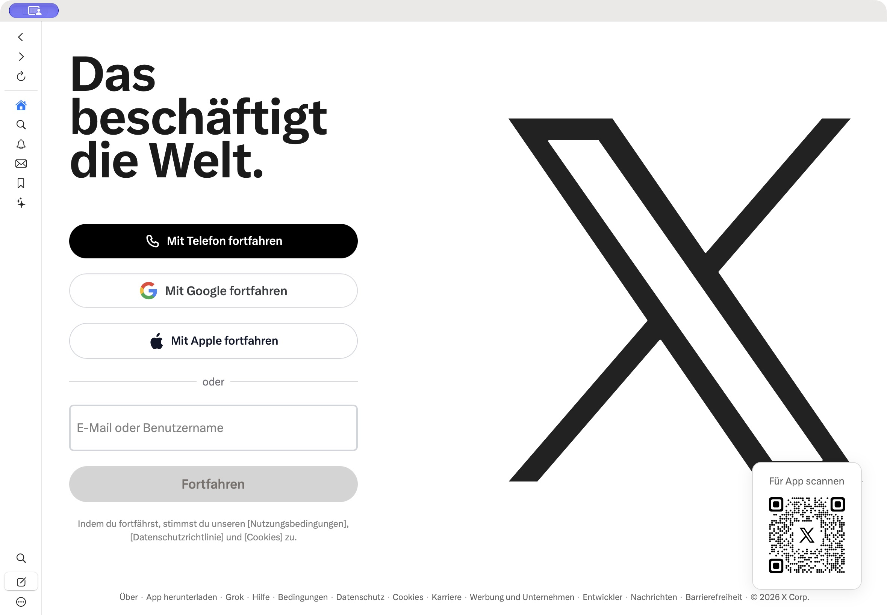
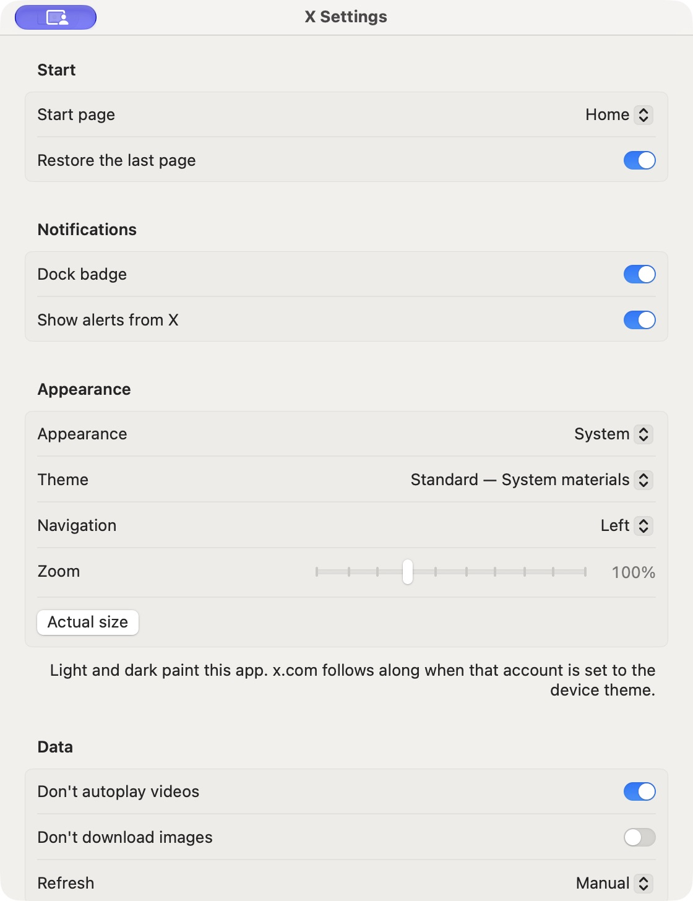

# X for Mac

x.com, back in the dock. a small SwiftUI app with WebKit underneath.

your timeline, messages, bookmarks, and posts are the real site. the app adds mac controls around it: navigation, shortcuts, themes, downloads, and a dock badge.

unofficial. not affiliated with X Corp.

[](https://github.com/p2plus/xmac/actions/workflows/ci.yml)

[get it running](#get-it-running) · [settings](#make-it-yours) · [shortcuts](#keyboard-stuff) · [privacy](PRIVACY.md) · [contributing](CONTRIBUTING.md)

## what it looks like



the actual app, signed out. navigation is on the left by default. menus follow the Mac language: English, German, French, Spanish, Japanese, Korean, and Simplified Chinese. the page language comes from x.com.

## get it running

**macOS 14+.** the easy way: grab the zip from [releases](https://github.com/p2plus/xmac/releases), unzip, and drop `X.app` into Applications. the app is ad-hoc signed, so the first launch needs a right-click → **Open** — after that macOS remembers (or strip the quarantine mark yourself: `xattr -d com.apple.quarantine /Applications/X.app`). the zip is built on Apple Silicon; on an Intel Mac, build from source.

for that you need **Xcode Command Line Tools with Swift 5.9+**:

```bash
git clone https://github.com/p2plus/xmac.git
cd xmac
./build.sh --run
```

that builds a release binary, packages `X.app`, signs it locally, and opens it. the first build takes a bit.

keep it in Applications:

```bash
cp -R X.app /Applications/
open /Applications/X.app
```

then right-click the dock icon → Options → Keep in Dock.

if `swift` is missing, install the tools first:

```bash
xcode-select --install
```

`./build.sh` builds without launching. the app is built for the Mac you run the command on. the signature is ad hoc; this is not a notarized installer.

## sign in once

use your normal x account. email or username and password work. a passkey does not: this build is ad-hoc signed, so it has no application identifier, and macOS refuses the sheet before it appears. Google and Apple use a separate sign-in window inside the app; the provider may open another one.

cookies stay in this app's WebKit store, so you stay signed in between launches. Safari's login does not carry over. the app does not read or save your password.

to start over: **Settings → Sign out and delete data**. that removes the local session and website data. your x account stays.

## what you can do

after sign-in, use x.com as usual: home, explore, notifications, messages, bookmarks, lists, profile, replies, and posts. lists and profile are also in the **More** menu (`…`).

- upload photos and videos through the macOS file picker
- play video fullscreen; autoplay is paused by default
- use camera and microphone on x.com when macOS grants access
- get macOS alerts from the open page while the app is running
- see unread counts from the page title on the dock icon, capped at `99+`
- download files to Downloads; they are not opened automatically
- open outside links in your browser; sensitive query fields are stripped first
- search x from the app's search field, or find text on the current page

## make it yours

open **X → Settings…** or press `⌘,`.



| setting | what it does |
| --- | --- |
| start page | home, explore, notifications, messages, or bookmarks |
| restore the last page | picks up where you left off; on by default |
| dock badge / alerts | turn either one off independently |
| appearance | system, light, or dark |
| theme | Standard, Ledger, Graphite, or Phosphor; changes the app's controls |
| navigation | left, right, top, or bottom |
| zoom | 70–160%, with a reset to actual size |
| don't autoplay videos | on by default |
| don't download images | off by default; enabling it also blocks avatars |
| refresh | manual, 1, 5, 15, 30, or 60 minutes; skips the composer |

the app's light/dark setting works best when your x account follows the device theme. the chrome themes style the app around the page; x.com keeps its own layout.

the disk cache is cleared on launch and every 15 minutes. cookies and local storage stay, so clearing the cache does not log you out.

## keyboard stuff

| shortcut | action |
| --- | --- |
| `⌘1` / `⌘2` / `⌘3` / `⌘4` / `⌘5` | home / explore / notifications / messages / bookmarks |
| `⌘7` / `⌘8` | lists / profile |
| `⌘N` / `⇧⌘N` | new post / new window |
| `⌘L` | search x |
| `⌘F` | find on page |
| `⌘G` / `⇧⌘G` | next / previous match |
| `⌘[` / `⌘]` | back / forward |
| `⌘R` / `⌥⌘R` | reload / reload from origin |
| `⌘+` / `⌘-` / `⌘0` | zoom in / out / actual size |
| `⇧⌘O` / `⇧⌘C` | open in browser / copy link |
| `⌘,` | settings |

## links into the app

`xmac://` and `twitter://` links can open here. after launching the app once, try:

```bash
open 'xmac://home'
open 'xmac://search?query=swift'
open 'xmac://compose?text=hello%20from%20mac'
```

the compose link opens a draft. you still press Post yourself. normal `https://` links from other apps keep opening in your browser.

## the bits worth knowing

- this needs an internet connection. there is no offline timeline.
- x.com controls the page and account features. if the site changes or breaks, the wrapper can be affected too.
- notifications come from the running page. there is no separate background push service after you quit.
- Google or Apple can reject an embedded sign-in flow. if that happens, use email or username and password.
- location is always denied. camera, microphone, and the upload picker are limited to x.com and twitter.com.
- a passkey needs Apple's browser entitlement, which ad-hoc signing cannot carry. email and password still sign you in.
- Copy Link and Open in Browser pass a cleaned URL, not your login session. opening the browser may ask you to sign in there.

more on cookies, permissions, and local data in [PRIVACY.md](PRIVACY.md).

## hacking on it

SwiftUI for the shell, WebKit for the site, Swift Package Manager for the build. no third-party package dependencies.

```bash
swift test
./build.sh
```

core logic and tests live in [`Sources/XMacCore`](Sources/XMacCore) and [`Tests/XMacTests`](Tests/XMacTests). the app lives in [`Sources/XMac`](Sources/XMac). packaging is in [`build.sh`](build.sh).

for web debugging, quit the app and launch the executable with the inspector enabled:

```bash
XMAC_INSPECT=1 ./X.app/Contents/MacOS/XMac
```

issues and PRs are welcome. say what you clicked, what happened, what you expected, and which macOS version you are on. leave account details and session data out of screenshots and logs.

small patches are easier to take than a rewrite. keep it a shell around the real site. [contribution notes here](CONTRIBUTING.md).

## license

[MIT](LICENSE). X and its branding belong to their respective owners.
